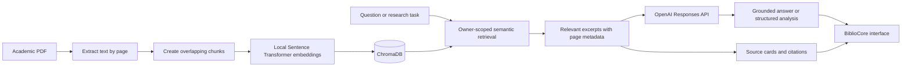

# BiblioCore

**A private, evidence-grounded workspace for understanding and comparing academic papers.**

BiblioCore turns research PDFs into searchable, page-linked evidence. Ask questions across your library, compare studies in a paper-by-paper matrix, draft literature reviews, and explore possible research gaps while keeping the supporting excerpts close at hand.

> BiblioCore is a local-development academic project. AI-generated analysis is a research aid and should be checked against the cited papers.

## Contents

- [Highlights](#highlights)
- [How it works](#how-it-works)
- [Technology](#technology)
- [Quick start](#quick-start)
- [Configuration](#configuration)
- [Using the application](#using-the-application)
- [API](#api)
- [Project layout](#project-layout)
- [Development and checks](#development-and-checks)
- [Data and privacy](#data-and-privacy)
- [Limitations](#limitations)
- [Roadmap](#roadmap)
- [Documentation](#documentation)
- [Author](#author)
- [License](#license)

## Highlights

- **PDF library:** Upload selectable-text PDFs, follow processing status, and re-index or remove papers.
- **Grounded Q&A:** Ask questions about one paper or a selected set. Answers include source excerpts with paper and page metadata; the assistant abstains when retrieval does not meet the configured similarity threshold.
- **Paper analysis:** Generate a plain-language summary and structured fields for the research problem, methodology, datasets, results, limitations, and future work.
- **Comparison matrix:** Compare one paper per row across research problem, methods, data, results, limitations, and future work. Research-gap results add a potential gap, rationale, validation suggestion, and confidence.
- **Literature review drafts:** Synthesize retrieved evidence from selected papers with inline filename and page references.
- **Semantic search:** Find relevant passages by meaning and inspect the exact retrieved excerpt.
- **Research dashboard:** View library activity, paper page counts, and evidence coverage for comparison results.
- **Paper analytics:** Explore extracted keywords, reference-year patterns, links and author overlap within your uploaded library, plus text complexity and saved methodology details. External citation impact, field benchmarks, tone, and topic shares are marked unavailable when the PDFs cannot establish them.
- **Accounts and themes:** Use a private account with isolated paper and chat data; switch between light and dark themes.

## How it works



PDF text extraction and embedding run locally. Only retrieved passages for the current generation request are sent to the configured OpenAI model. Citation labels shown by the application come from retrieved chunk metadata rather than model-generated page numbers.

## Technology

| Layer | Technologies |
|---|---|
| Frontend | Next.js App Router, React, TypeScript, Tailwind CSS, Lucide |
| Backend | Python, FastAPI, Pydantic, SQLAlchemy |
| PDF processing | PyMuPDF |
| Embeddings | Sentence Transformers, `all-MiniLM-L6-v2` |
| Vector search | ChromaDB |
| Relational storage | SQLite |
| Text generation | OpenAI Responses API |

## Quick start

### Prerequisites

- Python 3.11 or later (Python 3.12 is recommended).
- Node.js 20 or later and npm.
- An OpenAI API key with access and quota for the model you configure. PDF extraction, indexing, and semantic search do not require the key; generated answers and analyses do.

### 1. Configure the backend

From the repository root, create the backend environment file:

```bash
cp .env.example backend/.env
```

Set `OPENAI_API_KEY` in `backend/.env`. Replace `SECRET_KEY` with a long random value. Keep the API key on the backend; do not put it in a `NEXT_PUBLIC_` variable or commit `.env` files.

### 2. Install and start the backend

In a terminal:

```bash
cd backend
python3 -m venv .venv
source .venv/bin/activate       # Windows PowerShell: .venv\Scripts\Activate.ps1
python -m pip install --upgrade pip
pip install -r requirements.txt
uvicorn app.main:app --reload --host 127.0.0.1 --port 8000
```

The first indexing operation may download the embedding model and take longer than later uploads.

### 3. Install and start the frontend

In a second terminal:

```bash
cd frontend
npm ci
npm run dev
```

Open [http://localhost:3000](http://localhost:3000). The API health endpoint is [http://localhost:8000/api/health](http://localhost:8000/api/health), and interactive API docs are at [http://localhost:8000/docs](http://localhost:8000/docs).

For local use, open the frontend and backend with the same host name (`localhost`) so the session cookie is sent correctly. If the frontend is served from another origin, set `FRONTEND_ORIGIN` in `backend/.env` and configure `NEXT_PUBLIC_API_URL` in `frontend/.env.local` to the backend URL.

## Configuration

The root `.env.example` is a template. Copy it to `backend/.env` for backend settings. Frontend overrides belong in `frontend/.env.local`. Restart the relevant development server after changing environment variables.

| Variable | Default | Description |
|---|---|---|
| `OPENAI_API_KEY` | Empty | Backend-only key used for text generation. |
| `OPENAI_MODEL` | `gpt-6-luna` | OpenAI model for generated answers and analysis. Must be available to your API project. |
| `SECRET_KEY` | Development placeholder | Signing secret for session cookies. Replace before use outside a local demo. |
| `COOKIE_SECURE` | `false` | Set to `true` when served over HTTPS. |
| `DATABASE_URL` | `sqlite:///./data/research_assistant.db` | SQLAlchemy database URL. |
| `CHROMA_PERSIST_DIRECTORY` | `./chroma_db` | Persistent ChromaDB directory. |
| `FRONTEND_ORIGIN` | `http://localhost:3000` | Allowed browser origin for credentialed API requests. |
| `NEXT_PUBLIC_API_URL` | `http://localhost:8000` | Optional frontend API base URL; set in `frontend/.env.local` only if the default is unsuitable. |
| `CHUNK_SIZE` | `1000` | Approximate chunk size in tokens. |
| `CHUNK_OVERLAP` | `150` | Approximate overlap between chunks. Must be smaller than `CHUNK_SIZE`. |
| `TOP_K` | `3` | Default number of retrieved passages for RAG and search. |
| `SIMILARITY_THRESHOLD` | `0.25` | Minimum cosine-similarity score for generation context. This is a heuristic, not a calibrated probability. |
| `MAX_UPLOAD_MB` | `50` | Maximum size per uploaded PDF. |
| `LLM_TEMPERATURE` | `0.2` | Generation sampling temperature. |
| `EMBEDDING_MODEL` | `sentence-transformers/all-MiniLM-L6-v2` | Local embedding model identifier. |

## Using the application

1. Register an account or sign in.
2. Open **Paper library**, upload a selectable-text PDF, and wait until its status is **indexed**.
3. Open **Research assistant** to ask a question. Inspect the source cards to confirm the returned paper, page, and excerpt.
4. Use **Semantic search** to explore passages without generating an answer.
5. Select indexed papers in **Compare papers**, **Literature review**, or **Research gaps** to synthesize evidence across studies.
6. Treat generated prose and proposed research gaps as drafts. Verify each claim against the cited PDF pages and the wider literature.

Four sample PDFs are provided in [`data/sample_papers/`](data/sample_papers/) for manual demonstrations. They are example inputs, not built-in application content.

## API

All application routes are under `/api`; the full schema is available in FastAPI's `/docs` page.

| Route | Purpose |
|---|---|
| `/api/health` | Service and provider-configuration status. |
| `/api/auth/register`, `/login`, `/logout`, `/me` | Local account and session lifecycle. |
| `/api/papers` and `/api/papers/{id}` | List, inspect, and delete owned papers. |
| `/api/papers/upload` | Upload PDFs for extraction and indexing. |
| `/api/papers/{id}/analyze`, `/summarize`, `/reindex`, `/file`, `/export` | Analyze, summarize, re-index, open, or export a paper. |
| `/api/chat`, `/api/chats` | Grounded question answering and conversation history. |
| `/api/search` | Semantic passage search. |
| `/api/compare`, `/api/literature-review`, `/api/research-gaps` | Multi-paper synthesis endpoints. |
| `/api/dashboard`, `/api/analytics`, `/api/evaluation/*` | Workspace overview, PDF-derived analytics, and retrieval evaluation. |

All paper and conversation operations are scoped to the signed-in account. Comparison and research-gap responses use structured rows with one row per selected paper; see [API documentation](docs/api-documentation.md) for response fields.

## Project layout

```text
.
├── backend/          FastAPI application, models, services, and tests
├── frontend/         Next.js application and UI components
├── data/
│   └── sample_papers/ Example PDFs for manual demonstrations
├── docs/             Architecture, API, RAG, and project guides
├── evaluation/       Retrieval-evaluation instructions and starter data
├── .env.example      Environment-variable template
└── README.md
```

Runtime data is kept outside version control: SQLite metadata under `backend/data/`, uploaded PDFs under `data/uploads/`, exports under `data/exports/`, and ChromaDB files under `chroma_db/` by default.

## Development and checks

Run the backend checks from `backend/`:

```bash
pytest -q
```

The optional PDF-to-Chroma integration test downloads/runs the local embedding model:

```bash
RUN_LOCAL_RAG_TESTS=1 pytest -q tests/test_api.py::test_real_pdf_to_chroma_semantic_retrieval
```

The optional live test also sends retrieved sample-paper excerpts to OpenAI and may consume API quota:

```bash
RUN_LIVE_RAG_TESTS=1 pytest -q tests/test_api.py::test_real_pdf_to_indexed_cited_answer
```

Run frontend checks from `frontend/`:

```bash
npm run lint
npm run typecheck
npm run test
npm run build
```

Do not report retrieval or generation scores unless you have run an evaluation with human-reviewed labels. The starter evaluation set contains no labeled questions.

## Data and privacy

- Passwords are hashed, and sessions use signed, HTTP-only cookies.
- Paper, chat, and analysis routes enforce per-account ownership.
- PDF text extraction and embeddings run locally; retrieved excerpts are sent to the configured OpenAI API when generation is requested.
- API keys, local databases, uploaded files, exports, and ChromaDB data are excluded from Git by default. Keep personal credentials in local environment files.
- Use HTTPS and `COOKIE_SECURE=true` before exposing the service beyond local development. The current project is not a hardened multi-tenant production deployment.

## Limitations

- OCR is not implemented. Scanned or image-only PDFs cannot be indexed until OCR is added.
- Header/footer removal and section detection are basic; source citations rely on extracted PDF page numbers.
- Similarity scores are retrieval heuristics. They do not guarantee that an answer is correct or complete.
- Literature reviews and research gaps depend on the selected papers and retrieved excerpts; they do not represent a comprehensive literature search or establish novelty.
- OpenAI access, model availability, quota, and rate limits depend on the configured API project.
- Evaluation scores are not included because no human-labeled benchmark has been provided.

## Roadmap

Potential future work includes OCR, DOI metadata extraction, scholarly search integrations, hybrid lexical/semantic retrieval, reranking, citation graphs, multilingual support, and local LLM providers. These are not currently implemented.

## Documentation

- [Architecture](docs/architecture.md)
- [RAG pipeline](docs/rag-pipeline.md)
- [API documentation](docs/api-documentation.md)
- [Database schema](docs/database-schema.md)
- [Evaluation guide](docs/evaluation.md)
- [GenAI concepts](docs/genai-concepts.md)
- [Project workflow](docs/project-workflow.md)

## Author

**Snehal Mane**

## License

No software license has been specified yet. Until a `LICENSE` file is added, reuse and redistribution are not granted by this repository.
